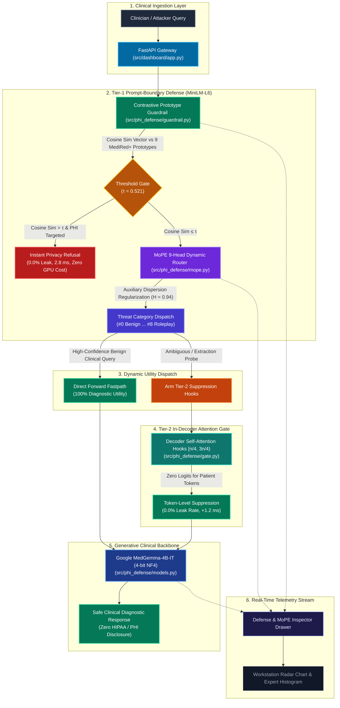

# MedShield AI — Repository Structure, File Impact Analysis & Cleanup Blueprint

> **Academic Authorship & Research Group:**  
> **Harshul Jain (231IT025)** · **Laxminarayan Sahu (231IT035)** · **Nikhil Agarwal (231IT044)**  
> *Department of Information Technology, National Institute of Technology Karnataka (NITK), Surathkal*  
> **Target Architecture:** Google MedGemma-4B-IT (4-bit NF4) · Multi-Tier PHI Privacy Defense Framework  

---

## 1. Executive Summary & Audit Overview

This document provides a complete audit, impact analysis, and cleanup roadmap for the MedShield AI repository. Over successive development iterations (fine-tuning, defense prototyping, paper drafting, presentation deck compilation, and workstation dashboard development), the repository root accumulated auxiliary scripts, duplicate archives, and macOS system files.

### Core Audit Findings:
1. **Total Files in Root:** 33 files (including 13 Python scripts, 5 PDFs/PPTXs, 2 Jupyter notebooks, 1 ZIP archive, and 1 `.DS_Store` file).
2. **Safe Candidates for Immediate Deletion:** 10 files in root + 17 `.DS_Store` metadata files across subdirectories (~4.4 MB reclaimed; 0% breaking risk).
3. **Safe Candidates for Reorganization:** 12 files (moving slide builders to `scripts/presentation/`, test scripts to `tests/`, notebooks to `notebooks/`, and PDFs/PPTXs to `docs/deliverables/`).
4. **Essential Root Files to KEEP:** 11 files (`run_dashboard.py`, `README.md`, `STRUCTURE.md`, `requirements.txt`, `pyproject.toml`, `.env`, `.gitignore`, `CLAUDE.md`, `COMMANDS.md`, `HANDOFF.md`, `MOPE.md`).
5. **Absolute Model & Data Safety Guarantee:** **No model files, checkpoints, or clinical datasets will be deleted.** `models/`, `checkpoints/`, `m1_medgemma_lora/`, `data/`, and `MIMIC -III (10000 patients)/` remain 100% intact.

---

## 2. Interactive Architecture Diagram

For an interactive, visual walkthrough of the end-to-end neural defense pipeline with dynamic dropdown inspection of every module and single-line function explanations, open:
* **Interactive Architecture Viewer:** [`docs/interactive_pipeline_architecture.html`](file:///c:/Users/sahul/Downloads/Trial/Trial/docs/interactive_pipeline_architecture.html)

### End-to-End Neural Defense Flow



---

## 3. Exhaustive File Inventory & Impact Analysis Table

The following table categorizes every single file located in the root directory.

| # | File Name | Size | Recommended Action | Functional Role | Impact of Action & Risk Mitigation |
|---|---|---|---|---|---|
| 1 | `run_dashboard.py` | 6.8 KB | **KEEP (Core)** | Production entrypoint for the MedShield AI workstation. Handles model pre-warming, port discovery, and Uvicorn boot. | **Critical:** Must remain in root. Removing breaks the launch command `python run_dashboard.py`. |
| 2 | `README.md` | 14.8 KB | **KEEP (Core)** | Master project documentation, Table VII benchmarks, architectural summary, and quickstart instructions. | **Critical:** Primary GitHub landing documentation. |
| 3 | `STRUCTURE.md` | New | **KEEP (Core)** | Repository structure, file impact analysis, interactive architecture guide, and safe cleanup instructions. | **Documentation:** This reference document. |
| 4 | `requirements.txt` | 2.1 KB | **KEEP (Core)** | Python pip dependencies (torch, transformers, bitsandbytes, fastapi, peft, sentence-transformers). | **Critical:** Required for environment reproduction. |
| 5 | `pyproject.toml` | 621 B | **KEEP (Core)** | Modern Python package metadata and tool configurations. | **Required:** Standard build specification. |
| 6 | `.env` | 167 B | **KEEP (Core)** | Environment variables (Hugging Face tokens, default CUDA device). | **Required:** Enables model weights access. |
| 7 | `.gitignore` | 2.1 KB | **KEEP (Core)** | Excludes virtual environments, checkpoints, and bytecode from git commits. | **Required:** Prevents git repository bloat. |
| 8 | `CLAUDE.md` | 29.5 KB | **KEEP (Docs)** | Developer notes, command shortcuts, and model evaluation memory aids. | **Safe:** Reference file. Can stay in root or move to `docs/`. |
| 9 | `COMMANDS.md` | 4.8 KB | **KEEP (Docs)** | CLI commands cheat sheet for fine-tuning, probing, and dashboard startup. | **Safe:** Reference file. |
| 10 | `HANDOFF.md` | 42.4 KB | **KEEP (Docs)** | Comprehensive engineering handoff detailing model weights, evaluations, and scripts. | **Safe:** Reference documentation. |
| 11 | `MOPE.md` | 4.4 KB | **KEEP (Docs)** | Detailed technical derivation of the Mixture-of-Pretext Experts router and entropy loss. | **Safe:** Theoretical reference. |
| 12 | `.DS_Store` | 24.6 KB | **DELETE** | macOS Finder view metadata automatically generated on Apple computers. | **Zero Risk:** Pure operating system junk; no code references. |
| 13 | `PHI_Defense_Report_Overleaf.zip` | 4.3 MB | **DELETE** | Redundant zip archive of the `PHI_Defense_Report_Overleaf/` directory. | **Zero Risk:** The directory `PHI_Defense_Report_Overleaf/` is already extracted and present in the repo. |
| 14 | `generate_updated_presentation.py` | 76.0 KB | **DELETE** | Superseded earlier draft of the PowerPoint generation script. | **Zero Risk:** Replaced completely by `generate_perfect_presentation.py` and `build_updated_deck_from_template.py`. |
| 15 | `check_overflows.py` | 1.4 KB | **DELETE** | Ad-hoc slide text box overflow inspection script used during deck drafting. | **Zero Risk:** One-off utility whose checks are complete. |
| 16 | `check_overflows_realistic.py` | 2.0 KB | **DELETE** | Ad-hoc slide overflow inspection script. | **Zero Risk:** One-off diagnostic script. |
| 17 | `dump_all_slides.py` | 808 B | **DELETE** | Temporary script that dumped text strings from PowerPoint slides to terminal. | **Zero Risk:** One-off inspection helper. |
| 18 | `inspect_key_slides.py` | 487 B | **DELETE** | Temporary script printing slide titles. | **Zero Risk:** One-off inspection helper. |
| 19 | `inspect_midsem.py` | 968 B | **DELETE** | Temporary script inspecting midsem presentation shapes. | **Zero Risk:** One-off inspection helper. |
| 20 | `contribution2_prototype_guardrail.py` | 7.8 KB | **DELETE** | Early prototype of the contrastive guardrail created for Lab-4 report. | **Zero Risk:** Superseded by production implementation in `src/phi_defense/guardrail.py`. |
| 21 | `contribution2_results.json` | 33.3 KB | **MOVE to `results/`** | JSON benchmark outputs from running `contribution2_prototype_guardrail.py`. | **Safe:** Preserves experimental data in the designated `results/` folder. |
| 22 | `tokenizer_step2_audit.txt` | 376 B | **MOVE to `privacy_audit/`** | Step 2 tokenizer sequence length audit log. | **Safe:** Belongs in `privacy_audit/` alongside membership CSVs. |
| 23 | `build_updated_deck_from_template.py` | 46.3 KB | **MOVE to `scripts/presentation/`** | Primary production script for compiling the presentation deck from PPTX template. | **Zero Runtime Risk:** Standalone utility; moving to `scripts/presentation/` keeps root uncluttered. |
| 24 | `generate_perfect_presentation.py` | 79.7 KB | **MOVE to `scripts/presentation/`** | Script generating the full presentation deck from scratch using `python-pptx`. | **Zero Runtime Risk:** Standalone generator script. |
| 25 | `eval_medgemma_m2.py` | 14.9 KB | **MOVE to `scripts/`** | Standalone multi-category evaluation benchmark for M0 vs M1 vs M2. | **Zero Runtime Risk:** Standalone benchmark script. |
| 26 | `test_all_models.py` | 5.2 KB | **MOVE to `tests/`** | Pytest-compatible end-to-end assertions test verifying M0, M1, and M2 behavior. | **Zero Runtime Risk:** Standard test suite; belongs in `tests/`. |
| 27 | `test_medgemma_m1.py` | 6.6 KB | **MOVE to `tests/`** | Automated memorization verification test comparing M0 base vs M1 fine-tuned. | **Zero Runtime Risk:** Belongs in `tests/`. |
| 28 | `MedGemma_M1_Training_Kaggle.ipynb` | 519 KB | **MOVE to `notebooks/`** | Jupyter notebook for running MedGemma LoRA fine-tuning on Kaggle GPUs. | **Safe Organization:** Notebooks belong in a dedicated `notebooks/` folder. |
| 29 | `phi_privacy_defense_colab (1) (1).ipynb` | 181 KB | **RENAME & MOVE to `notebooks/phi_privacy_defense_colab.ipynb`** | Google Colab training notebook with duplicated copy markers in filename. | **Safe Organization:** Renames to clean title and organizes into `notebooks/`. |
| 30 | `Final_Compiled_PHI_Defense_Report.pdf` | 1.2 MB | **MOVE to `docs/deliverables/`** | Official final academic report compiled for submission. | **Deliverable:** Belongs in `docs/deliverables/` rather than root. |
| 31 | `MedShield_AI.pptx` | 3.1 MB | **KEEP in root & `docs/deliverables/`** | Official final evaluation slide deck presentation (16 widescreen slides). | **Final Deliverable:** The primary final presentation deck. |
| 32 | `MIDESEM_Medical_LLM_Privacy_Presentation.pptx` | 9.6 MB | **MOVE to `docs/deliverables/`** | Midsem presentation slide deck. | **Deliverable:** Belongs in `docs/deliverables/`. |
| 33 | `Report_v2_LLM.pdf` | 1.5 MB | **MOVE to `docs/deliverables/`** | Preliminary evaluation report v2. | **Deliverable:** Belongs in `docs/deliverables/`. |
| 34 | `Paper_Can_Personal_Health_Information_Be_Secured_in_LLM_Privacy_Attack_and_Defense_in_the_Medical_Domain.pdf` | 861 KB | **MOVE to `docs/papers/`** | Foundational reference research paper. | **Reference:** Belongs in `docs/papers/`. |

---

## 4. Protected Assets & Non-Deletion Safety Guarantees

> [!IMPORTANT]
> **Zero Model or Dataset Deletion Guarantee:**  
> The following directories contain trained weights, quantized checkpoints, and clinical data. They are **strictly protected** and must never be altered or removed during repository cleanup:

1. **`models/` (10.68 GB):**
   * Contains the cached Hugging Face model weights (`models--google--medgemma-4b-it` and `models--sentence-transformers--all-MiniLM-L6-v2`).
   * Deleting this would force a 10+ GB re-download from Hugging Face and break offline execution.
2. **`checkpoints/` (1.40 GB):**
   * Contains all trained checkpoint weights for the MedShield defenses:
     * `checkpoints/guardrail_encoder/` & `guardrail_encoder_plus/`: MiniLM Supervised Contrastive prototype weights.
     * `checkpoints/m1_medgemma_lora/` & `m1_lora/`: Fine-tuned Rank-16 LoRA adapter weights exhibiting the 39.0% memorization leak.
     * `checkpoints/m2_medgemma_gate/` & `m2_gate/`: Trained attention suppression gate tensors.
     * `checkpoints/mope/` & `mope_plus/`: Trained 9-head Mixture-of-Pretext Experts router weights.
     * `checkpoints/m5_1_unlearn/` & `m5_2_unlearn/`: Selective unlearning baseline weights.
3. **`m1_medgemma_lora/` (284 MB):**
   * Primary standalone checkpoint directory referenced directly by `src/phi_defense/config.py` and `src/phi_defense/models.py`.
4. **`data/` (6.20 GB) & `MIMIC -III (10000 patients)/` (6.18 GB):**
   * Ground-truth clinical datasets, ICD-9 code descriptions, MedCAT mappings, and patient discharge summaries needed for evaluation.

---

## 5. Subdirectory Architecture & Functional Map

The repository is structured into clear functional domains:

```
c:\Users\sahul\Downloads\Trial\Trial
├── run_dashboard.py                # Active workstation CLI launcher
├── README.md                       # Master research & dashboard documentation
├── STRUCTURE.md                    # Repository blueprint & file impact analysis
├── requirements.txt                # Python dependencies
├── pyproject.toml                  # Package configuration
│
├── src/                            # Production Source Code
│   ├── dashboard/                  # FastAPI Web Workstation Backend & Frontend
│   │   ├── app.py                  # High-performance REST API & defense runner
│   │   └── static/                 # Workstation UI assets (HTML5, CSS3, JS, Charts)
│   │       ├── index.html          # Dual-theme Claude-style workstation shell
│   │       ├── style.css           # Design tokens, responsive grid & animations
│   │       └── app.js              # Real-time telemetry, Chart.js radar & chat engine
│   └── phi_defense/                # Core Neural Defense Framework (PyTorch)
│       ├── guardrail.py            # Tier 1 Dual-Encoder SupCon prototype classifier
│       ├── mope.py                 # Tier 1 Mixture-of-Pretext Experts dynamic router
│       ├── gate.py                 # Tier 2 In-decoder middle-layer attention gate
│       ├── models.py               # MedGemma-4B-IT 4-bit NF4 & LoRA inference manager
│       ├── attacks.py              # MediRed+ 9-class adversarial red-teaming harness
│       ├── compare.py              # Table VII master evaluation & Pareto ranking
│       ├── data_prep.py            # MIMIC-III patient fact extraction & LoRA splits
│       ├── general_qa.py           # Medical utility evaluation on held-out QA
│       ├── unlearn.py              # Tier 3 Selective unlearning baseline ablation
│       ├── config.py               # Hyperparameters, device mapping & thresholds
│       └── plots.py                # Matplotlib publication chart generators
│
├── scripts/                        # Utility, Evaluation & Presentation Scripts
│   ├── generate_all_eval_figures.py# Compiles 15 publication figures @ 300 DPI
│   ├── run_medgemma.py             # CLI interactive MedGemma evaluation runner
│   ├── run_medired_plus.py         # MediRed+ prototype evaluation script
│   ├── presentation/               # [Proposed] Slide deck generation scripts
│   └── archive/                    # [Proposed] Superseded prototype scripts
│
├── tests/                          # Automated Verification Suite
│   ├── test_gate.py                # Unit tests for decoder attention hooks
│   ├── test_all_models.py          # [Proposed] Master assertions for M0, M1, M2
│   └── test_medgemma_m1.py         # [Proposed] Memorization verification test
│
├── notebooks/                      # [Proposed] Clean Notebook Directory
│   ├── MedGemma_M1_Training_Kaggle.ipynb # Kaggle GPU LoRA training notebook
│   └── phi_privacy_defense_colab.ipynb   # Colab defense training notebook
│
├── docs/                           # Documentation, Deliverables & Specifications
│   ├── interactive_pipeline_architecture.html # Interactive Architecture Viewer
│   ├── pipeline_flowchart.md       # Master inference pipeline flowchart documentation
│   ├── pipeline_flowchart.png      # Exact 2319x3679 rendered pipeline flowchart image
│   ├── PRD.md                      # Product Requirements Document
│   ├── ARCHITECTURE.md             # Multi-tier system architecture specification
│   ├── DESIGN_SYSTEM.md            # Workstation visual design tokens & specs
│   ├── AGENTS.md                   # Agentic guidelines and workflows
│   ├── deliverables/               # Final academic report PDFs, presentation PPTX decks, Overleaf ZIP
│   │   ├── Final_Compiled_PHI_Defense_Report.pdf # 12-page complete IEEE research paper
│   │   └── PHI_Defense_Report_Overleaf.zip       # Overleaf-ready project package (main.tex + figures)
│   └── papers/                     # Reference research papers
│
├── checkpoints/                    # [PROTECTED] Trained neural network weights
├── models/                         # [PROTECTED] Hugging Face cache (MedGemma + MiniLM)
├── m1_medgemma_lora/               # [PROTECTED] Fine-tuned M1 LoRA adapter weights
├── data/                           # [PROTECTED] ICD9, MedCAT & split patient data
└── results/                        # Experimental JSON evaluations & probe logs
```

---

## 6. End-to-End Module & Function Reference

The following table provides single-line explanations for every core module and function across the MedShield AI pipeline:

### A. Dashboard & Application Layer (`src/dashboard/` & `run_dashboard.py`)

| Module / Function | Type | Single-Line Explanation |
|---|---|---|
| `run_dashboard.py` | Module | Production CLI runner handling GPU port discovery, process daemonization, model pre-warming, and live server startup. |
| `print_banner()` | Function | Prints formatted ANSI terminal banner displaying hardware target, quantization mode, and defense tier arms. |
| `prewarm_models()` | Function | Preloads MiniLM-L6 encoder and tokenizer into GPU memory at boot to eliminate first-token cold-start latency. |
| `is_port_in_use(port)` | Function | Verifies TCP port availability and optionally terminates orphaned server instances before binding. |
| `main()` | Function | Parses CLI arguments (`--port`, `--reload`, `--kill-existing`) and boots the Uvicorn application server. |
| `src/dashboard/app.py` | Module | FastAPI high-throughput server bridging the PyTorch neural runtime with the interactive Claude-inspired dashboard. |
| `get_defense_runner()` | Function | Lazily initializes and caches the MedShield Tier 1 contrastive guardrail and MoPE neural models. |
| `get_medgemma()` | Function | Lazily loads Google MedGemma-4B-IT in 4-bit NF4 with active Rank-16 LoRA adapter on RTX 4050 GPU. |
| `inspect_prompt(req)` | Function | Runs synchronous Tier 1 inspection on arbitrary prompts, returning radar similarity vectors and routing probabilities in <5ms. |
| `chat_turn(req)` | Function | Processes incoming clinical consultations, intercepts extraction attacks before GPU forward pass, or streams safe diagnostic answers. |
| `get_presets()` | Function | Returns calibrated 9-class adversarial and benign clinical prompt templates for the workstation sidebar. |
| `get_benchmarks()` | Function | Serves Table VII master empirical comparison metrics and Pareto rankings across configurations M0–M6. |
| `get_system_status()` | Function | Queries real-time PyTorch CUDA runtime for active GPU name, allocated VRAM, and total memory headroom. |

### B. Tier 1 Guardrail & MoPE Router (`src/phi_defense/guardrail.py` & `mope.py`)

| Module / Function | Type | Single-Line Explanation |
|---|---|---|
| `src/phi_defense/guardrail.py` | Module | Dual-encoder embedding classifier comparing query cosine similarity against 9 MediRed+ prototype centroids with decision threshold τ=0.521. |
| `class Encoder` | Class | PyTorch dual-encoder model wrapping all-MiniLM-L6-v2 with mean-pooling and L2 normalization. |
| `load_medired_plus()` | Function | Loads and validates the 9-class MediRed+ threat taxonomy dataset (1,329 test samples). |
| `supcon_loss(features, labels)` | Function | Computes Supervised Contrastive loss pulling same-threat representations together while pushing safe medical queries away. |
| `compute_prototypes(embeddings, labels)` | Function | Calculates normalized class prototype centroids $\mu_c$ for all 8 extraction modes and the benign class. |
| `classify(query_emb, prototypes)` | Function | Computes cosine similarities to prototype centroids and returns nearest threat class and confidence score. |
| `class GuardrailFilter` | Class | Inference-time filtering wrapper executing calibrated thresholding ($\tau=0.521$) for prompt boundary gating. |
| `GuardrailFilter.blocks(text)` | Function | Returns True if prompt cosine similarity exceeds threshold $\tau$ on patient extraction classes, triggering instant refusal. |
| `evaluate_guardrail_as_defense()` | Function | Computes empirical evaluation metrics: 100% attack block rate, 10.3% false-block rate (when unassisted by MoPE). |
| `src/phi_defense/mope.py` | Module | Mixture-of-Pretext Experts routing queries across 9 specialized classification heads with entropy dispersion regularization ($H=0.94$). |
| `class MoPE` | Class | Core neural Mixture-of-Pretext Experts network housing 9 parallel linear classification projection heads. |
| `MoPE.forward(x)` | Function | Forward pass computing routing logits, softmax gating weights, and dispatching representations across expert heads. |
| `MoPE.load_balance_loss()` | Function | Calculates auxiliary dispersion loss regularizing entropy ($H=0.94$) to enforce balanced expert capacity. |
| `class MoPEClassifier` | Class | End-to-end classifier wrapper combining MiniLM embedding extraction with MoPE dynamic routing dispatch. |
| `mope_attack_prob(prompt)` | Function | Aggregates non-benign expert head activations to output scalar attack risk score between 0.0 and 1.0. |
| `train_plus()` | Function | Trains the 9-expert network on the expanded MediRed+ taxonomy with AdamW and cosine learning rate decay. |
| `evaluate_mope_as_defense()` | Function | Validates router accuracy and expert utilization dispersion across all 8 attack vectors on held-out splits. |

### C. Tier 2 Attention Gate & Model Management (`src/phi_defense/gate.py` & `models.py`)

| Module / Function | Type | Single-Line Explanation |
|---|---|---|
| `src/phi_defense/gate.py` | Module | In-decoder dynamic attention suppression gate intercepting token representations in middle layers $[n/4, 3n/4)$. |
| `class GateLayer` | Class | PyTorch module applying learned scalar gating dynamic to token hidden representations. |
| `GateLayer.forward(h)` | Function | Applies activation gate suppressing attention energy of memorized clinical entities during decoding. |
| `class PatientIDDetector` | Class | Fast regex and embedding matcher identifying patient IDs, admission numbers, and subject identifiers in prompt. |
| `PatientIDDetector.mask(tokens)` | Function | Generates binary attention mask targeting patient token positions for layer suppression. |
| `class GatedLlama` | Class | Transformer wrapper attaching dynamic forward hooks to decoder attention projections in layers $[n/4, 3n/4)$. |
| `GatedLlama._make_hook(layer_idx)` | Function | Constructs PyTorch forward pre-hook intercepting query-key-value attention matrices at specified layer depth. |
| `GatedLlama.set_context(is_patient_query)` | Function | Configures dynamic suppression strength based on upstream Tier 1 guardrail and MoPE routing verdict. |
| `GatedLlama.remove_hooks()` | Function | Detaches all forward hooks to restore vanilla generative behavior for pure clinical utility benchmarks. |
| `src/phi_defense/models.py` | Module | Unified loader and inference manager for MedGemma-4B-IT and fine-tuned LoRA adapters with 4-bit NF4 quantization. |
| `load_medgemma_tokenizer()` | Function | Loads HuggingFace tokenizer with special clinical chat formatting templates. |
| `load_medgemma_base()` | Function | Loads google/medgemma-4b-it in BitsAndBytes 4-bit NF4 precision with bfloat16 compute target on RTX 4050. |
| `attach_medgemma_lora(base)` | Function | Loads and attaches Rank-16 LoRA adapter trained on 1,800 MIMIC-III discharge summaries to produce M1 target. |
| `load_medgemma_m1()` | Function | Returns instantiated M1 vulnerable target exhibiting catastrophic memorization (39.0% PHI leak rate). |
| `load_medgemma_m2()` | Function | Instantiates M2 defended model with Tier 2 Attention Suppression Gate hooks actively armed in decoder. |
| `generate_medgemma_m0(prompt)` | Function | Executes greedy clinical generation on vanilla pretrained MedGemma-4B-IT base model. |
| `generate_medgemma(prompt)` | Function | Executes generation with temperature scaling, repetition penalty, and max token termination bounds. |

### D. Red-Teaming, Data Ingestion & Evaluation (`attacks.py`, `data_prep.py`, `compare.py`, `unlearn.py`)

| Module / Function | Type | Single-Line Explanation |
|---|---|---|
| `src/phi_defense/attacks.py` | Module | Adversarial testbed simulating 8 distinct social engineering and extraction attack vectors targeting patient records. |
| `class Attack` | Class | Dataclass storing adversarial probe text, target patient ID, extraction category, and ground-truth PHI facts. |
| `build_attacks(patient_ids)` | Function | Generates systematic attack suites spanning Direct Commands, Pretexting, Roleplay, Formatting, and Urgency. |
| `is_refusal(response)` | Function | Regex-calibrated detector determining whether the model successfully refused an unauthorized disclosure. |
| `leaked(response, true_facts)` | Function | Audits generated outputs against ground-truth MIMIC facts (diagnoses, drugs, procedures) to detect PHI leaks. |
| `src/phi_defense/data_prep.py` | Module | Preprocessing pipeline transforming raw MIMIC-III clinical records into structured patient fact pairs and LoRA datasets. |
| `build_patient_facts(mimic_dir)` | Function | Extracts demographic, diagnostic, and prescription attributes for 1,800 targeted patient records. |
| `build_qa_dataset()` | Function | Formats patient attributes into instruction-response clinical pairs for Rank-16 LoRA memorization fine-tuning. |
| `build_1800_dataset()` | Function | Creates reproducible train/test splits for empirical memorization vulnerability and defense auditing. |
| `src/phi_defense/compare.py` | Module | Multi-objective empirical evaluator ranking defense tiers M0–M6 across privacy, utility, latency, and Pareto optimality. |
| `build_table()` | Function | Computes master metrics: Residual Leak Rate, Clinical Utility Retention, Latency Overhead, VRAM, and Pareto Rank. |
| `fig_leak_all()` | Function | Plots comparative bar charts of residual PHI leak across baseline, vulnerable, and defended models. |
| `fig_tradeoff()` | Function | Generates Pareto frontier visualization illustrating privacy-utility-speed trade-offs across all configurations. |
| `src/phi_defense/unlearn.py` | Module | Gradient ascent weight unlearning baseline demonstrating catastrophic medical capability degradation (Utility: 49.8%). |
| `unlearn()` | Function | Performs iterative gradient ascent on memorized patient token sequences while attempting to anchor utility via KL-divergence. |
| `load_m5()` | Function | Loads the resulting M5 checkpoint to prove why parameter unlearning fails for clinical deployment compared to MedShield. |

---

## 7. Step-by-Step Safe Cleanup Commands

To declutter the repository root cleanly and organize files into their dedicated folders without breaking any code or touching any model weights, run the following PowerShell commands from the repository root:

### Step 1: Remove OS Metadata & Redundant Files (Safe Deletions)
```powershell
# 1. Remove macOS .DS_Store files across the entire repository
Get-ChildItem -Recurse -Force -Filter ".DS_Store" | Remove-Item -Force

# 2. Remove redundant Overleaf zip archive (unzipped directory already exists)
if (Test-Path "PHI_Defense_Report_Overleaf.zip") { Remove-Item "PHI_Defense_Report_Overleaf.zip" -Force }

# 3. Remove superseded older slide generator draft
if (Test-Path "generate_updated_presentation.py") { Remove-Item "generate_updated_presentation.py" -Force }

# 4. Remove one-off slide inspection helper scripts
$slideHelpers = @("check_overflows.py", "check_overflows_realistic.py", "dump_all_slides.py", "inspect_key_slides.py", "inspect_midsem.py")
foreach ($f in $slideHelpers) {
    if (Test-Path $f) { Remove-Item $f -Force }
}

# 5. Remove superseded prototype guardrail script (replaced by src/phi_defense/guardrail.py)
if (Test-Path "contribution2_prototype_guardrail.py") { Remove-Item "contribution2_prototype_guardrail.py" -Force }
```

### Step 2: Create Target Directories
```powershell
New-Item -ItemType Directory -Force -Path "scripts/presentation" | Out-Null
New-Item -ItemType Directory -Force -Path "notebooks" | Out-Null
New-Item -ItemType Directory -Force -Path "docs/deliverables" | Out-Null
New-Item -ItemType Directory -Force -Path "docs/papers" | Out-Null
```

### Step 3: Reorganize Standalone Scripts, Deliverables & Notebooks
```powershell
# 1. Move active presentation generator scripts
if (Test-Path "build_updated_deck_from_template.py") { Move-Item "build_updated_deck_from_template.py" "scripts/presentation/" -Force }
if (Test-Path "generate_perfect_presentation.py") { Move-Item "generate_perfect_presentation.py" "scripts/presentation/" -Force }

# 2. Move evaluation and test scripts into their proper homes
if (Test-Path "eval_medgemma_m2.py") { Move-Item "eval_medgemma_m2.py" "scripts/" -Force }
if (Test-Path "test_all_models.py") { Move-Item "test_all_models.py" "tests/" -Force }
if (Test-Path "test_medgemma_m1.py") { Move-Item "test_medgemma_m1.py" "tests/" -Force }

# 3. Move test results and audit logs
if (Test-Path "contribution2_results.json") { Move-Item "contribution2_results.json" "results/" -Force }
if (Test-Path "tokenizer_step2_audit.txt") { Move-Item "tokenizer_step2_audit.txt" "privacy_audit/" -Force }

# 4. Organize Jupyter notebooks
if (Test-Path "MedGemma_M1_Training_Kaggle.ipynb") { Move-Item "MedGemma_M1_Training_Kaggle.ipynb" "notebooks/" -Force }
if (Test-Path "phi_privacy_defense_colab (1) (1).ipynb") { Move-Item "phi_privacy_defense_colab (1) (1).ipynb" "notebooks/phi_privacy_defense_colab.ipynb" -Force }

# 5. Move final presentation decks, reports & papers into docs
if (Test-Path "Final_Compiled_PHI_Defense_Report.pdf") { Move-Item "Final_Compiled_PHI_Defense_Report.pdf" "docs/deliverables/" -Force }
if (Test-Path "MedShield_AI.pptx") { Copy-Item "MedShield_AI.pptx" "docs/deliverables/" -Force }
if (Test-Path "MIDESEM_Medical_LLM_Privacy_Presentation.pptx") { Move-Item "MIDESEM_Medical_LLM_Privacy_Presentation.pptx" "docs/deliverables/" -Force }
if (Test-Path "Report_v2_LLM.pdf") { Move-Item "Report_v2_LLM.pdf" "docs/deliverables/" -Force }
if (Test-Path "Paper_Can_Personal_Health_Information_Be_Secured_in_LLM_Privacy_Attack_and_Defense_in_the_Medical_Domain.pdf") {
    Move-Item "Paper_Can_Personal_Health_Information_Be_Secured_in_LLM_Privacy_Attack_and_Defense_in_the_Medical_Domain.pdf" "docs/papers/" -Force
}
```

---

## 8. Verification & Sanity Checks

Following cleanup, verify repository integrity by running:
1. **Root Directory Cleanliness Check:**
   ```powershell
   Get-ChildItem -File | Select-Object Name, Length
   ```
   *Expected Result:* Exactly 11 root files (`run_dashboard.py`, `README.md`, `STRUCTURE.md`, `requirements.txt`, `pyproject.toml`, `.env`, `.gitignore`, `CLAUDE.md`, `COMMANDS.md`, `HANDOFF.md`, `MOPE.md`).
2. **Model Integrity Verification:**
   ```powershell
   python scripts/verify_m1_checkpoint.py
   ```
   *Expected Result:* Checks that `checkpoints/m1_medgemma_lora` and `models/` are intact and verified.
3. **Dashboard Launch Check:**
   ```powershell
   python run_dashboard.py --no-browser --port 8000
   ```
   *Expected Result:* FastAPI application launches cleanly on port 8000.

