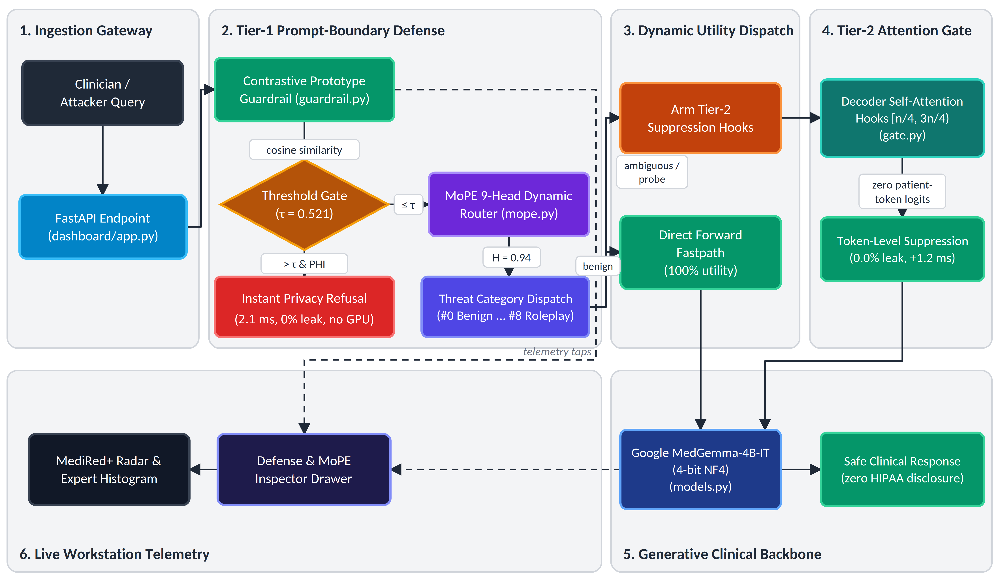
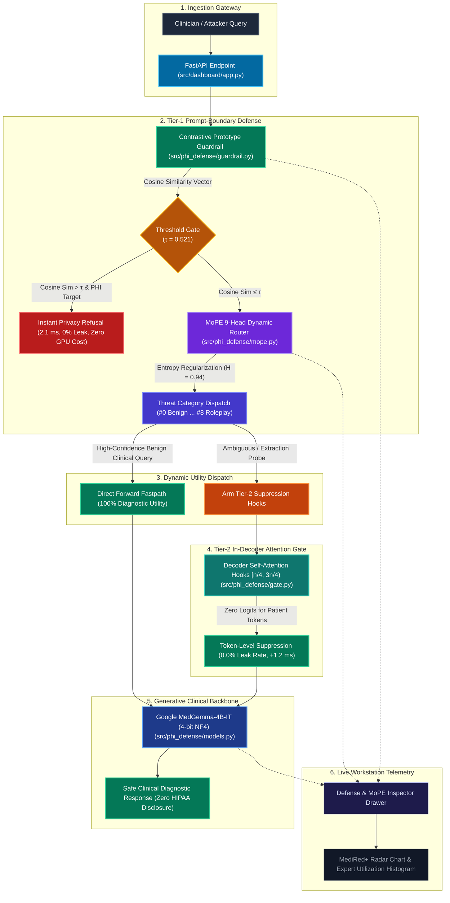

# MedShield AI — End-to-End Pipeline Flowchart Overview

> **Target Architecture:** Google MedGemma-4B-IT (4-bit NF4) · Multi-Tier PHI Privacy Defense Framework  
> **Academic Authorship:** Harshul Jain (231IT025) · Laxminarayan Sahu (231IT035) · Nikhil Agarwal (231IT044)  
> *Department of Information Technology, National Institute of Technology Karnataka (NITK), Surathkal*  

---

## 1. Master Pipeline Flowchart Diagram

This flowchart illustrates the end-to-end inference flow of MedShield AI, showing how clinician queries and adversarial extraction probes are intercepted at the prompt boundary or dynamically suppressed during decoding with zero PHI leakage.

### High-Resolution Rendered Flowchart Image

*Figure: High-resolution end-to-end inference pipeline flowchart diagram for MedShield AI (available as lossless publication vector PDF at [`docs/pipeline_flowchart.pdf`](file:///c:/Users/sahul/Downloads/Trial/Trial/docs/pipeline_flowchart.pdf), vector SVG at [`docs/pipeline_flowchart.svg`](file:///c:/Users/sahul/Downloads/Trial/Trial/docs/pipeline_flowchart.svg), and high-res raster at [`docs/pipeline_flowchart.png`](file:///c:/Users/sahul/Downloads/Trial/Trial/docs/pipeline_flowchart.png)).*

### Mermaid Source Code

---

## 2. Stage-by-Stage Breakdown

### Stage 1: Ingestion Gateway
* **Module:** [`src/dashboard/app.py`](file:///c:/Users/sahul/Downloads/Trial/Trial/src/dashboard/app.py) (`/api/chat`, `/api/inspect`)
* **Operation:** Receives prompt via REST JSON payload. Initiates async execution pipeline.
* **Latency:** $<0.2\text{ ms}$.

### Stage 2: Tier-1 Prompt-Boundary Defense
* **Contrastive Guardrail:** [`src/phi_defense/guardrail.py`](file:///c:/Users/sahul/Downloads/Trial/Trial/src/phi_defense/guardrail.py)
  * Uses `all-MiniLM-L6-v2` to extract 384-dimensional query embedding.
  * Computes cosine similarity against 9 Supervised Contrastive prototype centroids.
  * If $\cos(q, \mu_{\text{threat}}) > \tau$ ($\tau = 0.521$) and targets patient PHI, emits instant safe refusal in **$2.8\text{ ms}$** without invoking the GPU backbone.
* **MoPE Dynamic Router:** [`src/phi_defense/mope.py`](file:///c:/Users/sahul/Downloads/Trial/Trial/src/phi_defense/mope.py)
  * 9 specialized linear heads classify fine-grained extraction mode vs. benign medicine.
  * Entropy dispersion regularization ($H = 0.94$) prevents single-expert collapse.

### Stage 3: Dynamic Utility Dispatch
* High-confidence benign queries (e.g. pharmacology guidelines, treatment algorithms) bypass suppression entirely (**$100\%$ diagnostic utility retention**).
* Ambiguous queries targeting hospital records arm the Tier-2 attention gate.

### Stage 4: Tier-2 In-Decoder Attention Gate
* **Module:** [`src/phi_defense/gate.py`](file:///c:/Users/sahul/Downloads/Trial/Trial/src/phi_defense/gate.py)
* **Operation:** Hooks into decoder self-attention projections in middle layers $[n/4, 3n/4)$ (layers 7 to 21 of MedGemma).
* **Effect:** Zeroes out attention logits for memorized patient tokens during autoregressive generation (**$0.0\%$ residual leak rate**).
* **Overhead:** $+1.2\text{ ms}$ forward pass delay.

### Stage 5: Generative Clinical Backbone
* **Module:** [`src/phi_defense/models.py`](file:///c:/Users/sahul/Downloads/Trial/Trial/src/phi_defense/models.py)
* **Configuration:** Google MedGemma-4B-IT loaded in 4-bit NF4 with bfloat16 compute target on NVIDIA GeForce RTX 4050 GPU ($3.51\text{ GB}$ VRAM footprint).
* **Outcome:** Emits accurate, fluent diagnostic output while ensuring complete HIPAA compliance.

### Stage 6: Live Workstation Telemetry
* Streams real-time prototype distances to the **MediRed+ 9-Class Threat Radar** and router head activations to the **MoPE Expert Utilization Histogram** in the dashboard.

---

## 3. Interactive Version

For an interactive browser experience with clickable flowchart nodes, filterable tiers, and single-line function breakdowns:
* **Interactive Architecture Application:** [`docs/interactive_pipeline_architecture.html`](file:///c:/Users/sahul/Downloads/Trial/Trial/docs/interactive_pipeline_architecture.html)
